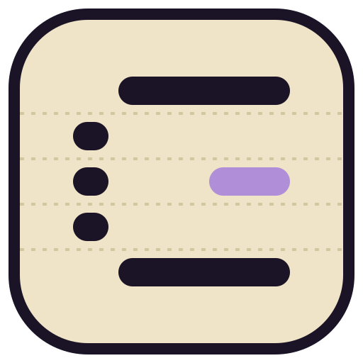
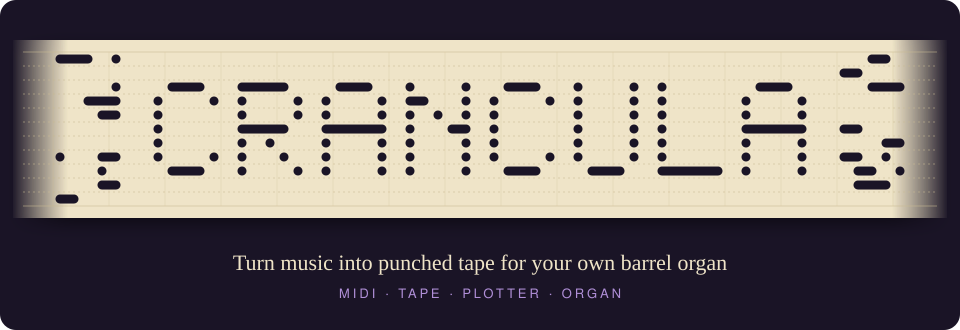
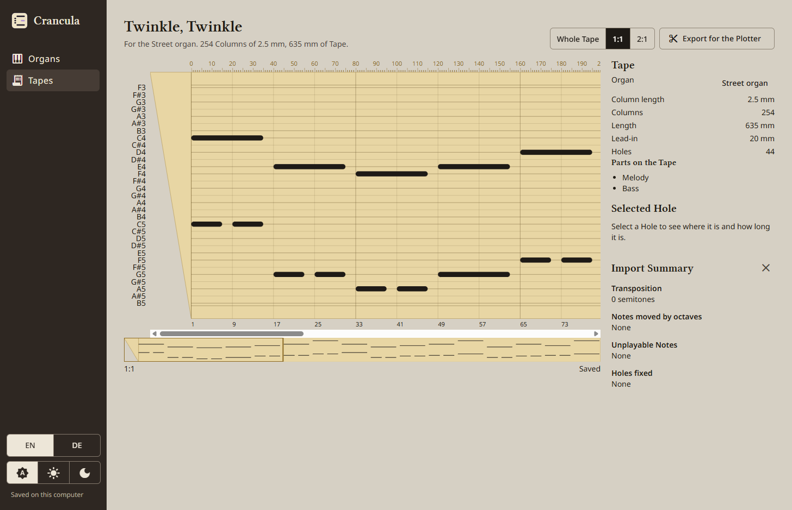
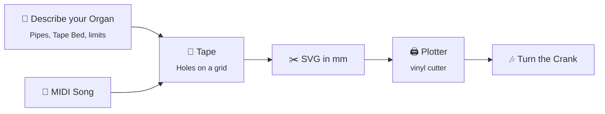
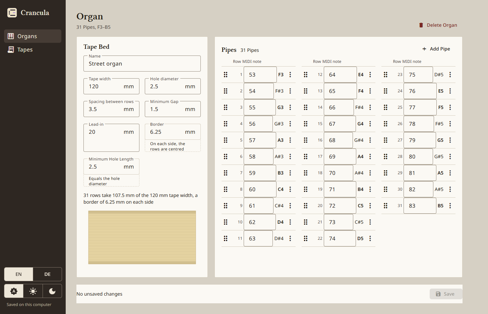
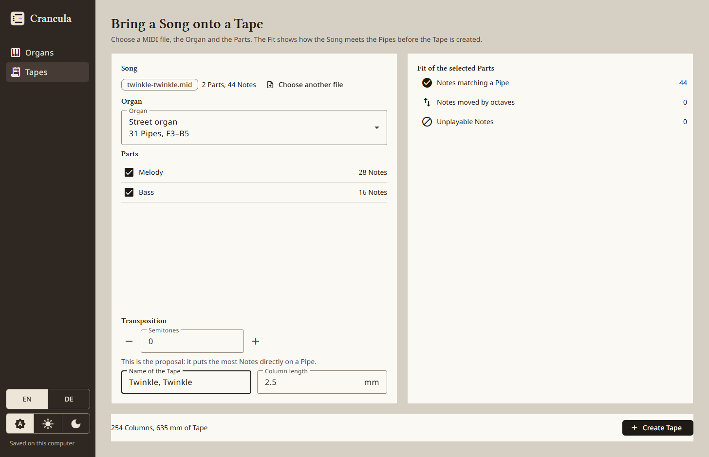
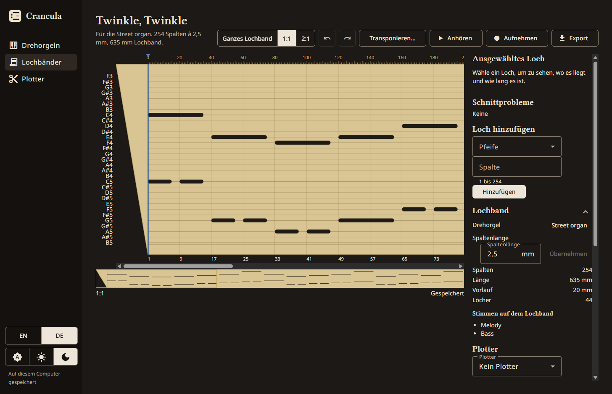

<p align="center">
  
</p>

<p align="center">
  
</p>

<p align="center">
  <a href="https://github.com/LilSticky/crancula/actions/workflows/ci.yml"></a>
  
  
  <a href="LICENSE"></a>
</p>

<p align="center">
  
  
  
</p>

---

**Crancula** is a desktop app for people who own a barrel organ (German: *Drehorgel*) that plays
punched paper tape. You describe your Organ, bring in a song as a MIDI file, and Crancula lays it
out as a Tape that fits your Pipes. You then export the Tape as an SVG that a vinyl cutter or
other Plotter can punch. Feed the Tape into your Organ, turn the Crank, and it plays.

> [!NOTE]
> **v0.2.0 is out.** Describe your Organ, bring a MIDI Song onto a Tape, edit its Holes by hand,
> hear it at your Crank speed and export it for your Plotter: the whole way from music to a
> cuttable Tape works. Crancula is a hobby project, so expect rough edges.
> [Download it](#download) for Windows, macOS or Linux.

<p align="center">
  
</p>

## How it works



1. **Describe your Organ.** List its Pipes by the notes they play (C4, D4, …) and measure its
   Tape Bed: tape width, hole diameter and row spacing in mm (Crancula works out the Border). Crancula refuses Organs
   that can't exist, for example duplicate Pipes or more Pipes than fit on the tape.
2. **Bring a Song onto a Tape.** Import a MIDI file. Crancula shifts it up or down
   (Transposition) so that it fits the Pipes your Organ has.
3. **Edit the Tape.** Add, move, lengthen and remove Holes, transpose them or change the
   Column length. Cutting Problems show as you go, and Undo takes any edit back.
4. **Hear the Tape.** Preview plays it with a tone per Pipe at the Crank speed you choose, while
   a playhead runs along the Tape. Your Organ needs its Tape per Crank turn for this.
5. **Record the Tape.** Save the whole Tape at its Crank speed as a WAV or MP3 file to listen to
   without Crancula.
6. **Punch the Tape.** Export the Tape as a true-to-scale SVG and cut it with your Plotter.
   A Tape that can't be cut (a Hole too short, or too close to the next) is not exported;
   Crancula names every problem Hole instead.

## Screenshots

<table>
  <tr>
    <td width="50%"></td>
    <td width="50%"></td>
  </tr>
  <tr>
    <td><b>Describe your Organ.</b> Its Tape Bed and its Pipes; Crancula derives the Border.</td>
    <td><b>Bring a Song onto a Tape.</b> Pick the Parts; the Fit shows how the Song meets your Pipes.</td>
  </tr>
  <tr>
    <td colspan="2"></td>
  </tr>
  <tr>
    <td colspan="2"><b>Edit the Tape</b> at 1:1 or 2:1, transpose its Holes and export it for the Plotter. Light or dark, English or German.</td>
  </tr>
</table>

## What's in v0.2.0

- [x] **Describe my organ**: create, edit, reorder and delete Organs, kept across restarts, in English and German
- [x] **Bring a song onto a tape**: import a MIDI file onto a Tape, with automatic Transposition ([#2](https://github.com/LilSticky/crancula/issues/2))
- [x] **Punch a tape**: export the Tape as an SVG for a vinyl cutter ([#3](https://github.com/LilSticky/crancula/issues/3))
- [x] **Edit a tape**: place Holes by hand, transpose Holes, change the Column length, with undo and redo ([#103](https://github.com/LilSticky/crancula/issues/103))
- [x] **Crank a tape**: hear a Tape at an adjustable Crank speed, with a playhead, before cutting it ([#149](https://github.com/LilSticky/crancula/issues/149))
- [x] Downloadable releases for Windows, macOS and Linux ([#11](https://github.com/LilSticky/crancula/issues/11))

What changed in each version is under [Releases](#releases).

<details>
<summary><b>Ideas for later</b></summary>

- More Song Sources: MusicXML, PDF, printed Scores
- More Plotter formats: DXF, HPGL; splitting long Tapes into pieces
- Export a Song as audio or as Scores

</details>

The full plan lives in [ROADMAP.md](documentation/ROADMAP.md), and the current state in
[STATUS.md](documentation/STATUS.md).

## A few words

Crancula uses the same words everywhere: in the app, in the code and here.

| Word | Meaning |
|------|---------|
| **Organ** | Your barrel organ: its Pipes, its Tape Bed and the limits of its mechanism |
| **Pipe** | Plays one note. Each Pipe has one row on the Tape |
| **Tape** | A punched strip that holds one song for one Organ. Rows are Pipes, columns are time |
| **Hole** | One note: a slot in a Pipe's row. The longer the slot, the longer the note |
| **Tape Bed** | The surface the Tape runs over: tape width, hole diameter and row spacing; the Border is derived |
| **Lead-in** | The blank Tape before the first Column, with an angled start; 0 if your Organ needs none |
| **Minimum Hole Length / Minimum Gap** | The shortest Hole, and the smallest space between two Holes, that your Organ can tell apart |
| **Crank** | You turn it to draw the Tape through the Organ. Its speed sets the tempo |
| **Crank speed / Tape per Crank turn** | How fast you turn the Crank (turns per minute), and how much Tape one turn draws (mm) |
| **Preview** | Hearing a Tape in Crancula, as the Organ would play it, before you cut it |
| **Plotter** | The machine that cuts the Holes, such as a vinyl cutter |

All terms, with their German names, are in the [dictionary](documentation/DICTIONARY.md).

## Releases

| Version | Date | Highlights |
|---------|------|------------|
| [0.2.0](https://github.com/LilSticky/crancula/releases/tag/v0.2.0) | 2026-10-24 | Hear a Tape before cutting it: Preview with a playhead; Crank speed per Tape; Tape per Crank turn for the Organ |
| [0.1.1](https://github.com/LilSticky/crancula/releases/tag/v0.1.1) | 2026-10-23 | Edit a Tape's Holes by hand; transpose Holes; change the Column length; undo and redo |
| [0.1.0](https://github.com/LilSticky/crancula/releases/tag/v0.1.0) | 2026-10-18 | Export a Tape for the Plotter as SVG; Lead-in; derived Border; a new look |
| [0.0.1](https://github.com/LilSticky/crancula/releases/tag/v0.0.1) | 2026-10-14 | Describe your Organ; bring a MIDI Song onto a Tape; English and German |

Every change per version is in the [changelog](CHANGELOG.md).

## Download

Get the [latest release](https://github.com/LilSticky/crancula/releases/latest):

| System | File |
|--------|------|
| Windows | portable `.exe`, no installation |
| macOS (Apple silicon) | `.dmg` |
| Linux | `.AppImage` |

The builds are not code-signed. On Windows, SmartScreen asks for confirmation: choose
*More info → Run anyway*. On macOS, if Gatekeeper reports the app as damaged, run
`xattr -cr /Applications/crancula.app`.

### Run it from source

You need [Node.js](https://nodejs.org/) 24 and Git:

```bash
git clone https://github.com/LilSticky/crancula.git
cd crancula
npm install
npm run electron:local
```

<details>
<summary><b>More commands for developers</b></summary>

| Command | What it does |
|---------|--------------|
| `npm start` | Angular dev server plus Electron, with live reload |
| `npm run electron:build` | Package the app for distribution |
| `npm test` | Unit and component tests (Vitest) |
| `npm run e2e` | End-to-end tests in Electron (Playwright) |
| `npm run lint` | ESLint |
| `npm run i18n:check` | Check that English and German translations match |

</details>

## Under the hood

Crancula is an [Electron](https://www.electronjs.org/) app with an [Angular](https://angular.dev/)
and Angular Material user interface, written in strict TypeScript. The domain model (Organs,
Tapes, Holes) is plain TypeScript that knows nothing about Angular or Electron. Your data stays
on your computer, as snapshot files in the app's user data folder.

It is built in small slices, each named after something you can do. Every slice starts as a
written spec ([Spec Kit](https://github.com/github/spec-kit)) and is built test-first, largely by
[Claude Code](https://claude.com/claude-code) agents working in a fixed loop. If you want to look
inside or help out, start here:

- [AGENTS.md](AGENTS.md): how work is done in this repository
- [Architecture decisions](documentation/adr/README.md)
- [Constitution](.specify/memory/constitution.md): principles and the Definition of Done
- [Issues](https://github.com/LilSticky/crancula/issues): bugs, slices and open questions

## Acknowledgements

- [@tonejs/midi](https://www.npmjs.com/package/@tonejs/midi): a MIDI file reader for JavaScript
- [SabinT/musicbox-svg](https://github.com/SabinT/musicbox-svg): an inspiration for turning music into cuttable SVG strips

## License

[MIT](LICENSE) © Lil Sticky
