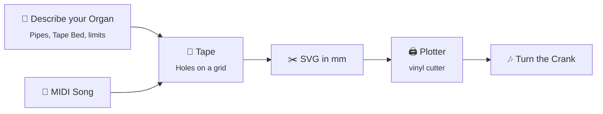

<p align="center">
  
</p>

<p align="center">
  
</p>

<p align="center">
  <a href="https://github.com/LilSticky/crancula/actions/workflows/ci.yml"></a>
  
  
  <a href="LICENSE"></a>
</p>

<p align="center">
  
  
  
</p>

---

**Crancula** is a desktop app for people who own a barrel organ (German: *Drehorgel*) that plays
punched paper tape. You describe your Organ, bring in a song as a MIDI file, and Crancula lays it
out as a Tape that fits your Pipes. You then export the Tape as an SVG that a vinyl cutter or
other Plotter can punch. Feed the Tape into your Organ, turn the Crank, and it plays.

> [!NOTE]
> **Early days.** Crancula is a hobby project working towards its first version, v0.1. You can
> describe your Organ today. Making a Tape from a song and exporting it come next. There's no
> download yet; see [Try it](#try-it) to run it from source.

## How it works



1. **Describe your Organ.** List its Pipes by the notes they play (C4, D4, …) and measure its
   Tape Bed: tape width, border, hole diameter and row spacing in mm. Crancula refuses Organs
   that can't exist, for example duplicate Pipes or more Pipes than fit on the tape.
2. **Bring a Song onto a Tape.** Import a MIDI file. Crancula shifts it up or down
   (Transposition) so that it fits the Pipes your Organ has.
3. **Punch the Tape.** Export the Tape as a true-to-scale SVG and cut it with your Plotter.

## Roadmap to v0.1

- [x] **Describe my organ**: create, edit, reorder and delete Organs, kept across restarts, in English and German
- [ ] **Bring a song onto a tape**: import a MIDI file onto a Tape, with automatic Transposition ([#2](https://github.com/LilSticky/crancula/issues/2))
- [ ] **Punch a tape**: export the Tape as an SVG for a vinyl cutter ([#3](https://github.com/LilSticky/crancula/issues/3))
- [ ] Downloadable releases for Windows, macOS and Linux ([#11](https://github.com/LilSticky/crancula/issues/11))

<details>
<summary><b>Ideas for later</b></summary>

- **Edit a Tape**: add, stretch, move and remove Holes; transpose the whole Song or single notes
- **Crank a Tape**: hear a preview at an adjustable crank speed
- **Air Demand**: warn when too many Pipes play at once
- More Song Sources: MusicXML, PDF, printed Scores
- More Plotter formats: DXF, HPGL; splitting long Tapes into pieces
- Export a Song as audio or as Scores

</details>

The full plan lives in [ROADMAP.md](documentation/ROADMAP.md), and the current state in
[STATUS.md](documentation/STATUS.md).

## A few words

Crancula uses the same words everywhere: in the app, in the code and here.

| Word | Meaning |
|------|---------|
| **Organ** | Your barrel organ: its Pipes, its Tape Bed and the limits of its mechanism |
| **Pipe** | Plays one note. Each Pipe has one row on the Tape |
| **Tape** | A punched strip that holds one song for one Organ. Rows are Pipes, columns are time |
| **Hole** | One note: a slot in a Pipe's row. The longer the slot, the longer the note |
| **Tape Bed** | The surface the Tape runs over: tape width, border, hole diameter and row spacing |
| **Minimum Hole Length / Minimum Gap** | The shortest Hole, and the smallest space between two Holes, that your Organ can tell apart |
| **Crank** | You turn it to draw the Tape through the Organ. Its speed sets the tempo |
| **Plotter** | The machine that cuts the Holes, such as a vinyl cutter |

All terms, with their German names, are in the [dictionary](documentation/DICTIONARY.md).

## Try it

Until the first release is out, you need [Node.js](https://nodejs.org/) 22 and Git:

```bash
git clone https://github.com/LilSticky/crancula.git
cd crancula
npm install
npm run electron:local
```

<details>
<summary><b>More commands for developers</b></summary>

| Command | What it does |
|---------|--------------|
| `npm start` | Angular dev server plus Electron, with live reload |
| `npm run electron:build` | Package the app for distribution |
| `npm test` | Unit and component tests (Vitest) |
| `npm run e2e` | End-to-end tests in Electron (Playwright) |
| `npm run lint` | ESLint |
| `npm run i18n:check` | Check that English and German translations match |

</details>

## Under the hood

Crancula is an [Electron](https://www.electronjs.org/) app with an [Angular](https://angular.dev/)
and Angular Material user interface, written in strict TypeScript. The domain model (Organs,
Tapes, Holes) is plain TypeScript that knows nothing about Angular or Electron. Your data stays
on your computer, as snapshot files in the app's user data folder.

It is built in small slices, each named after something you can do. Every slice starts as a
written spec ([Spec Kit](https://github.com/github/spec-kit)) and is built test-first, largely by
[Claude Code](https://claude.com/claude-code) agents working in a fixed loop. If you want to look
inside or help out, start here:

- [AGENTS.md](AGENTS.md): how work is done in this repository
- [Architecture decisions](documentation/adr/README.md)
- [Constitution](.specify/memory/constitution.md): principles and the Definition of Done
- [Issues](https://github.com/LilSticky/crancula/issues): bugs, slices and open questions

## Acknowledgements

- [@tonejs/midi](https://www.npmjs.com/package/@tonejs/midi): a MIDI file reader for JavaScript
- [SabinT/musicbox-svg](https://github.com/SabinT/musicbox-svg): an inspiration for turning music into cuttable SVG strips

## License

[MIT](LICENSE) © Lil Sticky
